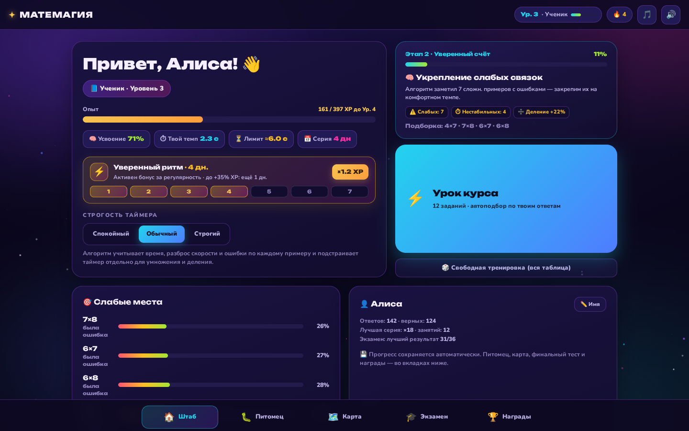
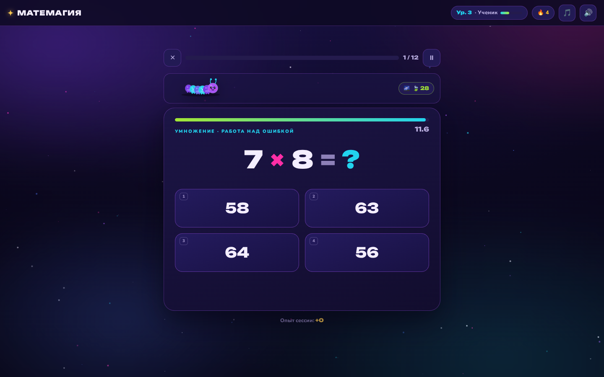
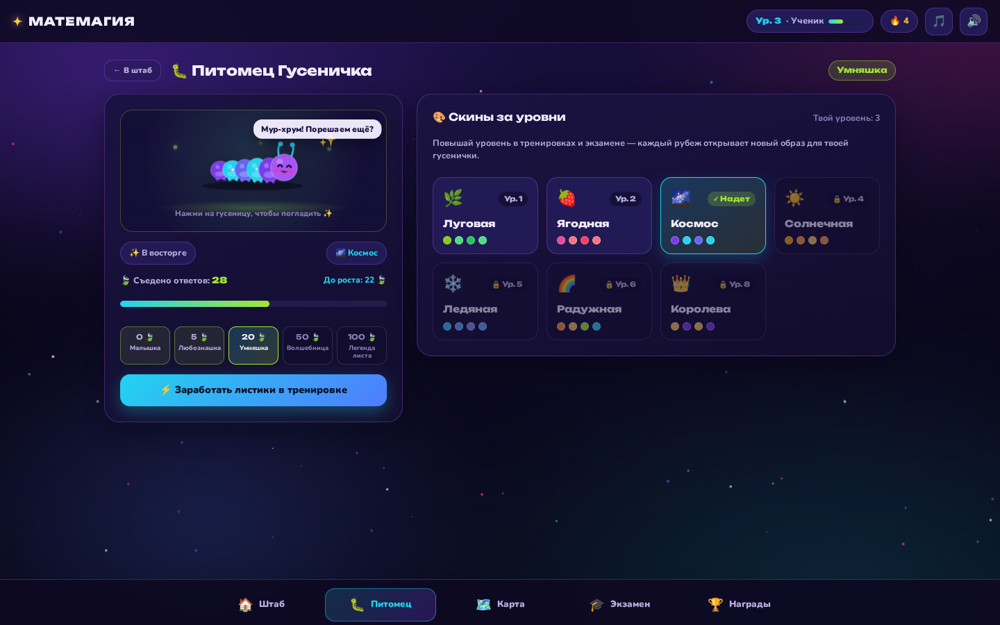
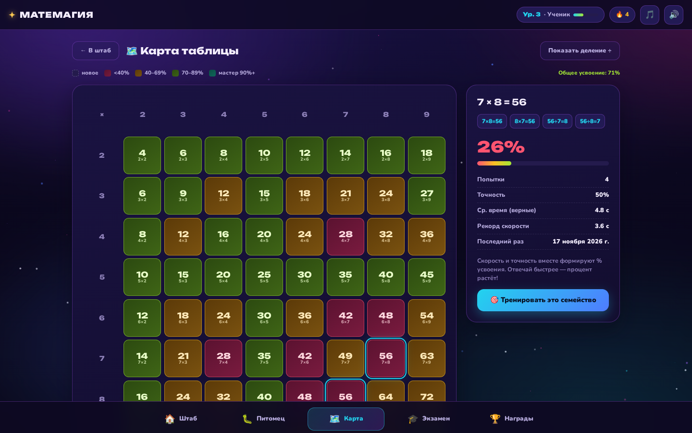

<div align="center">

# ✦ МАТЕМАГИЯ

**Умный тренажёр таблицы умножения и деления, в который хочется возвращаться каждый день**

[](https://ai.studio/apps/44fcd899-e73d-4a57-9f8f-2e6aeef3d589?fullscreenApplet=true)
[](#возможности-продукта)
[](./LICENSE)

<br />

> **«Матемагия» превращает зубрёжку таблицы умножения в космическое приключение:**  
> персональный темп, умный подбор примеров, питомец-гусеничка и именной сертификат в финале.

<br />

[**🚀 Открыть онлайн-тренажёр**](https://ai.studio/apps/44fcd899-e73d-4a57-9f8f-2e6aeef3d589?fullscreenApplet=true) · [**✨ Возможности**](#-возможности-продукта) · [**📸 Скриншоты**](#-как-это-выглядит) · [**🎓 Экзамен и сертификат**](#-финальный-экзамен-и-сертификат) · [**⚙️ Запуск**](#-быстрый-запуск-для-разработчиков)

</div>

---

<div align="center">
  
  <br />
  <sub><b>Главный экран («Штаб»)</b> — персональный курс, серия дней, слабые места и быстрый старт урока</sub>
</div>

---

## 💡 Зачем создана «Матемагия»

Обычные тренажёры показывают случайные примеры: ребёнок десятки раз решает лёгкое `2 × 2`, быстро скучает, но всё равно спотыкается на `7 × 8` или обратном делении `56 ÷ 7`.

**«Матемагия» решает эту задачу иначе — как внимательный персональный репетитор:**
- 🧠 **Понимает, что именно вызывает трудности** — фиксирует точность, скорость и разброс времени по каждому из 36 семейств примеров.
- ⏱ **Не давит лишним стрессом** — адаптирует таймер под темп конкретного ученика (отдельно для умножения и деления) и предлагает 3 режима строгости: *Спокойный*, *Обычный* и *Строгий*.
- 🐛 **Мотивирует без навязчивости** — каждый правильный ответ кормит любимого питомца, приближает новый скин и открывает достижения.
- 🔒 **Полная приватность** — работает прямо в браузере, без регистрации, паролей и рекламы. Весь прогресс автоматически сохраняется на устройстве.

---

## ✨ Возможности продукта

### 1. Умный адаптивный курс из 5 этапов
Вместо хаотичного перебора примеров алгоритм ведёт ученика по продуманной программе:
1. **Этап 1 · Опорные числа** — умножение на `2`, `5` и квадраты (`2×2…9×9`).
2. **Этап 2 · Уверенный счёт** — связки с тройкой и четвёркой.
3. **Этап 3 · Продвинутый уровень** — примеры на `6` и закономерности `×9`.
4. **Этап 4 · Сложное ядро** — трудные пары вроде `6×7`, `7×8` и баланс деления.
5. **Этап 5 · Свободное владение** — интервальное повторение и доведение реакции до автоматизма (`< 2.5 с`).

Если система замечает, что деление даётся медленнее умножения или на конкретном примере недавно была ошибка, следующий урок автоматически фокусируется на укреплении именно этих связок.

### 2. Интерактивный питомец Гусеничка
У каждого ученика есть виртуальный компаньон, который живёт прямо на экране тренировки:
- 🍃 **Растёт от правильных ответов** — проходит 5 стадий взросления: *Малышка → Любознашка → Умняшка → Волшебница → Легенда листа*.
- 💬 **Живые эмоции** — радуется комбо-сериям, хрустит листиками, подбадривает при промахе и мурчит, если её погладить.
- 🎨 **7 коллекционных скинов** — открываются по мере роста уровня: *Луговая, Ягодная, Космос, Солнечная, Ледяная, Радужная* и *Королева*.

### 3. Наглядная карта усвоения таблицы
Вся таблица от `2×2` до `9×9` собрана на одной интерактивной тепловой карте:
- Переключение между **умножением (`×`)** и **делением (`÷`)** в один клик.
- Цветовая индикация прогресса по каждой ячейке: от *«нового»* и *«требует внимания»* (`<40%`) до *«мастера»* (`90%+`).
- Подробная карточка любого семейства примеров (например, `7×8=56`, `8×7=56`, `56÷7=8`, `56÷8=7`) с точностью, средним временем и кнопкой **прицельной тренировки**.

### 4. Игровая мотивация и комфорт
- 🔥 **Ежедневные серии** — регулярные занятия дают бонус к опыту от **+10%** (за 2 дня) до **+50% XP** (за 7+ дней подряд).
- 🏆 **14 достижений и 7 рангов** — путь от *Искры* до *Легенды таблицы*.
- 🎹 **Удобное управление** — на компьютере можно отвечать клавишами `1–4`, пропускать паузу после ответа через `Enter`/`Пробел` и ставить урок на паузу по `Esc`; на планшете и телефоне — крупные кнопки выбора.
- 🎵 **Атмосфера космоса** — звёздный фон со спецэффектами, мягкая фоновая музыка и звуковые эффекты, которые можно отключить в шапке одним нажатием.

---

## 📸 Как это выглядит

<table>
  <tr>
    <td width="50%" align="center">
      
      <br />
      <sub><b>Экран тренировки</b> — крупный пример, адаптивный таймер, подсказка причины подбора и питомец рядом</sub>
    </td>
    <td width="50%" align="center">
      
      <br />
      <sub><b>Питомец Гусеничка</b> — стадии роста за съеденные ответы и гардероб из 7 скинов за уровни</sub>
    </td>
  </tr>
  <tr>
    <td colspan="2" align="center">
      
      <br />
      <sub><b>Интерактивная карта таблицы</b> — тепловая матрица 2–9 и детальная статистика по выбранному семейству примеров</sub>
    </td>
  </tr>
</table>

---

## 🎓 Финальный экзамен и сертификат

Когда база пройдена, ученик может проверить себя в **Финальном тесте**:
- **36 заданий** — вся таблица от `2×2` до `9×9` без подсказок, чередование умножения и деления.
- **Повышенная точность** — таймер на 10% строже обычного, чтобы проверить уверенное владение.
- **Именной сертификат 📜** — за идеальный результат `36 из 36` генерируется праздничный диплом Академии Матемагии с именем ученика, который можно сразу скачать в PNG и распечатать.

---

## 📊 Как устроен экран результатов

После каждой сессии (12 заданий в курсе или 10 в фокус-тренировке) ученик и родитель получают понятный отчёт:
- Итоговая оценка от **`S`** до **`D`**, точность и среднее время ответа.
- Прирост общего процента усвоения таблицы и список примеров, где скорость/уверенность выросли сильнее всего.
- Кнопка **«Разобрать ошибки»** — мгновенный мини-урок ровно по тем примерам, где случился промах.

---

## ⚙️ Быстрый запуск (для разработчиков)

Проект написан на **React + TypeScript + Vite** и не требует настройки базы данных или бэкенда для локальной работы.

```bash
# 1. Клонировать репозиторий
git clone https://github.com/your-username/matemagia.git
cd matemagia

# 2. Установить зависимости
npm install

# 3. Запустить в режиме разработки (порт 3000)
npm run dev
```

### Полезные команды

| Команда | Назначение |
| :--- | :--- |
| `npm run dev` | Запуск локального сервера разработки |
| `npm run build` | Сборка оптимизированной версии в `dist/` |
| `npm run preview` | Предпросмотр собранного проекта |
| `npm run lint` | Проверка типов TypeScript (`tsc --noEmit`) |

<details>
<summary><b>Технологический стек и структура проекта</b></summary>

- **Frontend:** React 19, TypeScript, Vite, Motion, Lucide React
- **Звук и графика:** Web Audio API (процедурный синтез эффектов и эмбиента), Canvas 2D (звёздное небо, конфетти и генерация PNG-сертификата)
- **Хранение данных:** `localStorage` (автосохранение без внешнего сервера)
- **Ключевые модули:**
  - `src/game/engine.ts` — адаптивный алгоритм подбора примеров, расчёт мастерства, интервальные повторения, достижения, скины питомца
  - `src/game/audio.ts` — звуковой движок
  - `src/components/` — экраны приложения (`HubScreen`, `GameScreen`, `PetScreen`, `MapScreen`, `ExamScreen`, `AchScreen`, `ResultsScreen`)

</details>

---

## 📄 Лицензия

Проект распространяется под лицензией **MIT** — подробности в файле [LICENSE](./LICENSE).

<div align="center">
  <br />
  Сделано с любовью к математике и красивому обучению ✨
</div>
